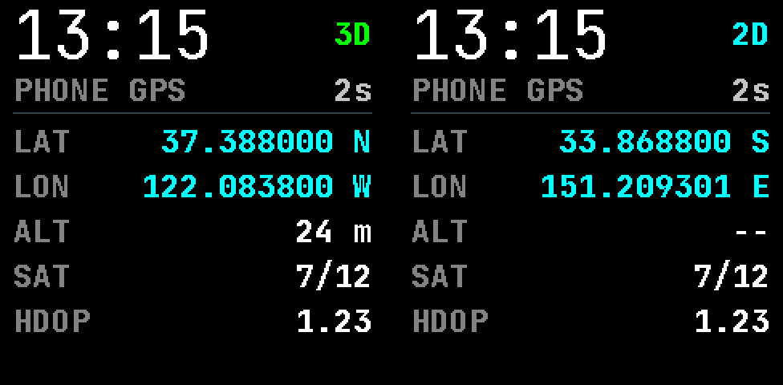
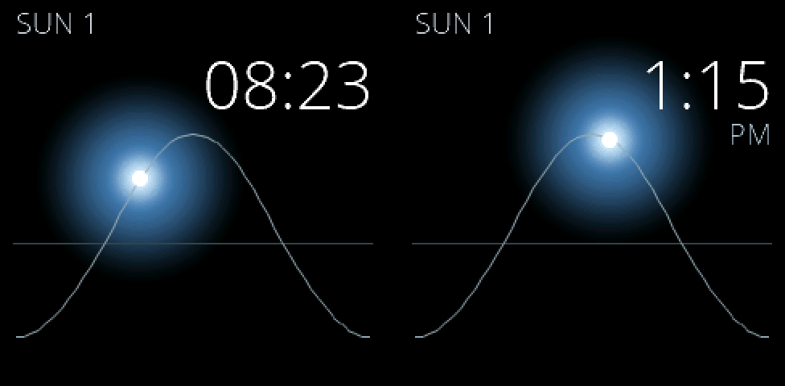
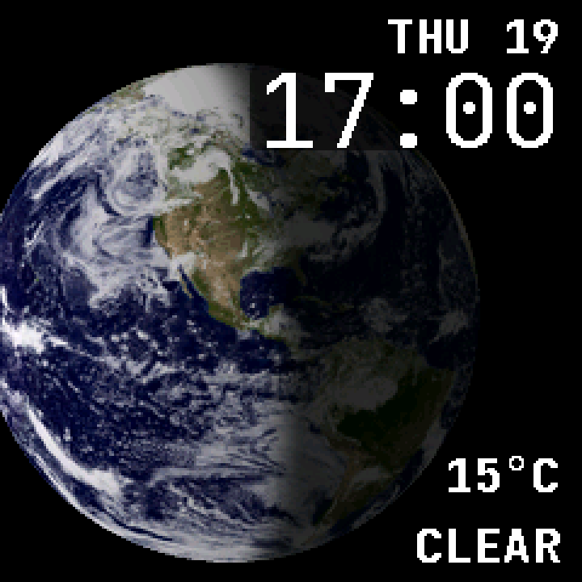

# PineTime wf4

A custom InfiniTime **1.16.1-wf4** development draft for the PINE64 PineTime. It adds watch faces, independent face selection, combined clock tools and an accelerometer diagnostic screen. The firmware starts from [InfiniTime 1.16.1](https://github.com/InfiniTimeOrg/InfiniTime), commit `e172b9b3c447e2b79c45510c751855a090a208b4`; upstream history, documentation and pinned submodules are retained.

**The current GPS draft is built and tested locally. It has not been installed on a watch. Its phone GPS companion has not been installed, and live phone-to-watch GPS has not been verified.** Preview coordinates are synthetic test values.



## Faces and controls

Nine faces are compiled:

| Face | Description |
| --- | --- |
| Digital | Upstream digital face |
| Analog | Weather temperature in the upper-left corner, heart rate in the lower-left |
| Terminal | Upstream terminal face |
| Weather focus | LCD-style weather display, Paris and Tokyo clocks, alarm indicator |
| Elegant | Two hands and tick marks; no digits, seconds or complications |
| Binary | 24-hour hours, minutes and seconds in three binary columns |
| Earth | Photographic Earth globe with UTC-based day/night shading, time and weather |
| Solar | Muted blue solar glow following a curved daily track |
| GPS | Phone-provided fix status, coordinates, altitude, satellites, HDOP and sample age |

In **Settings → Watch face**, check the faces you want in the cycle. Swipe **right to left** from a clock face to move to the next enabled, available face. Swipe **left to right** still opens Quick Settings. The selector has three pages with 4, 4 and 1 choices. Saved face IDs remain stable; IDs for removed faces are reserved.

On Analog, tap the upper-left temperature to open Weather. Heart rate is sampled when Analog becomes visible and then every ten minutes while it remains visible; sampling stops when the face is hidden. A reading or a 30-second timeout ends each attempt.

Clock Tools combines Alarm, Timer and Stopwatch. This profile removes games, Paint, Steps and accelerometer-based raise/shake/lower wake controls, and adds an I²C accelerometer diagnostic app. It is intended for development with a watch whose accelerometer is unavailable.





Earth uses a fixed historical NASA cloud composite, not live satellite imagery. Its lighting requires a synchronized time zone and a supported UTC date; otherwise the globe is neutral and shows `SYNC TIME`. Solar uses valid current-day sunrise/sunset values when supplied by weather telemetry, with a **06:00/18:00 fallback**. Its curve is a time-of-day illustration, not a location-accurate solar-altitude display. The existing version-0 weather feed does not supply sunrise/sunset, so it uses that fallback.

## GPS draft

PineTime has no GPS receiver. The optional [phone companion](codex/companion/README.md) reads an already-enabled ModemManager GNSS source on a Linux phone and forwards reports to the connected watch. It honors the phone's location switch. It does not enable GNSS, start gpsd, pair, scan or initiate a connection.

The face shows latitude/longitude to six decimal places with N/S/E/W, reported fix dimension, altitude in metres or feet, satellites used/in view, HDOP and age. Altitude requires a reported 3D fix and an altitude value. HDOP is dimensionless; it is not presented as accuracy in metres. Satellite auxiliary reports may be cached by ModemManager.

At 30 seconds, measurements disappear and the face shows `STALE`. Disconnect/reconnect clears the previous sample. `NO PHONE`, `NO DATA` and `WAIT` distinguish unavailable states; missing values remain dashes. Unknown fix dimension may retain a valid horizontal position, indicated by `.`. Re-reading a cached phone report does not refresh its receiver timestamp. The companion does not log coordinates, altitude, raw NMEA, payloads or location hashes.

GPS uses an encrypted write-only 20-byte characteristic in namespace `0006`, fitting the default ATT MTU. Weather retains namespace `0005`. See the [wire protocol](codex/companion/protocol.md). Existing GATT service ordering is preserved and the appended GPS range is announced through Service Changed. **Rediscovery with an existing live bond remains untested.** It depends on the saved Service Changed subscription; inherited bond/CCCD persistence behavior still needs hardware verification. A future GPS deployment also needs the new companion included in OTA service stop/restore handling.

## Build

Firmware source stays in the upstream layout (`src/`, `doc/`, `docker/`). Custom tests, companion code, previews, asset provenance and recorded verification belong under `codex/`. Build outputs and downloaded toolchains are ignored.

Clone this repository with its pinned submodules:

```sh
git clone --branch codex/wf4-draft --recurse-submodules https://github.com/Mathew-Hart/pinetime-firmware.git pinetime-wf4
cd pinetime-wf4
git submodule update --init --recursive
```

The recorded build used GNU Arm Embedded **10.3-2021.10**, Nordic **nRF5 SDK 15.3.0_59ac345**, Python **3.11.1**, CMake **3.31.6**, Ninja **1.11.1**, Node **20.19.0** and `lv_font_conv` **1.5.2**. The host tests used Clang with C++20 support. The ARM toolchain and Nordic SDK are downloaded separately; see the upstream [native build instructions](doc/buildAndProgram.md). The SDK retains its own license.

Prepare the Python environment and font converter from the publication's dependency locks:

```sh
python3.11 -m venv .venv
. .venv/bin/activate
python -m pip install -r codex/requirements-build.txt
npm ci --prefix codex/tooling
export PATH="$PWD/codex/tooling/node_modules/.bin:$PATH"
```

Set these two variables to your extracted downloads, then build the application target:

```sh
export ARM_NONE_EABI_TOOLCHAIN_PATH="$PWD/.deps/gcc-arm-none-eabi-10.3-2021.10"
export NRF5_SDK_PATH="$PWD/.deps/nRF5_SDK_15.3.0_59ac345"
cmake -G Ninja -S . -B build \
  -U WATCHFACE_TYPES -U USERAPP_TYPES \
  -DCMAKE_TOOLCHAIN_FILE="$PWD/cmake-nRF5x/arm-gcc-toolchain.cmake" \
  -DARM_NONE_EABI_TOOLCHAIN_PATH="$ARM_NONE_EABI_TOOLCHAIN_PATH" \
  -DARM_NONE_EABI_TOOLCHAIN_BIN_PATH="$ARM_NONE_EABI_TOOLCHAIN_PATH/bin" \
  -DNRF5_SDK_PATH="$NRF5_SDK_PATH" \
  -DPython3_EXECUTABLE="$PWD/.venv/bin/python3" \
  -DCMAKE_BUILD_TYPE=Release -DTARGET_DEVICE=PINETIME \
  -DBUILD_DFU=1 -DBUILD_RESOURCES=0
cmake --build build --target pinetime-mcuboot-app --parallel 8
```

Fonts are generated during this build and are also used by the native LVGL tests. `sh codex/build-local.sh` provides the same application build with tool overrides and an optional `PINETIME_DEPS_ROOT` containing the extracted dependencies. The target produces an application DFU archive under `build/src/`. These commands do not access a phone or watch. The upstream [Docker workflow](doc/buildWithDocker.md) is another build option; its floating dependency downloads are not an exact reproduction of the recorded environment. Source paths and generated metadata can affect output hashes, so a rebuild is not promised to be byte-identical to the recorded archive.

## Tests and recorded results

After the ARM build has generated the fonts, `sh codex/run-tests.sh` runs all host suites. The individual commands are:

```sh
python codex/tests/gps-service/run-native.py
sh codex/tests/gps-face/run-ui.sh
sh codex/tests/face-selection/run-ui.sh
python -m unittest discover -s codex/companion -p 'test_*.py' -v
python codex/tests/protocol-roundtrip/verify.py
```

The tests use actual firmware codecs, settings, selection logic and LVGL screens, with explicit host substitutes at hardware, RTOS and Bluetooth boundaries. They do not connect to a device or read real location. The service/store and Python-to-C++ wire tests use AddressSanitizer and UndefinedBehaviorSanitizer. PNG previews are generated from the actual 240×240 LVGL framebuffers.

The latest local verification recorded:

| Check | Result |
| --- | --- |
| Release ARM application build | Passed, no warnings or errors |
| GPS service/store | 1,012 native assertions |
| Actual GPS LVGL screen | 1,441 assertions |
| Actual face selector, persistence and cycle | 180 assertions |
| Native total | 2,633 assertions |
| Phone parser/bridge | 38 tests |
| Python encoder → C++ decoder | 6 wire cases |

Recorded source, test, font and render hashes are retained with the [verification receipts](codex/receipts/publication-validation.json). These results describe the local GPS draft, including its retained earlier features; they do not establish live GPS or hardware behavior.

| Memory area | Recorded use | Remaining |
| --- | --- | --- |
| Application flash | 428,032 / 474,632 bytes | 46,600 bytes |
| Static RAM | 24,072 / 65,536 bytes | 41,464 bytes for heap and stacks |

Static RAM is a linker measurement, not free runtime heap. The GPS host LVGL suite peaked at 7,168 allocated bytes, 4,760 above baseline; twelve screen lifetimes returned to baseline. This is a counted host allocation, not a live watch FreeRTOS heap measurement.

The recorded application-only package is [pinetime-wf4-gps-draft-dfu.zip](codex/artifacts/pinetime-wf4-gps-draft-dfu.zip), 429,059 bytes. SHA-256:

```text
b58965d0d25af1a427a9c52b5a76b8cebc2f30d5d824907c46958917c131f41c
```

Its manifest, CRC16 and MCUboot image digest were checked. It contains **no bootloader, recovery or external resource payload**. No automatic flashing or phone installation is part of the build/test workflow.

## License and attribution

InfiniTime and these firmware changes are distributed under [GPL-3.0-or-later](LICENSE), with the upstream copyright and license notices retained. Dependencies and bundled fonts retain their respective licenses and credits; see [the upstream font documentation](src/displayapp/fonts/README.md) and individual dependency notices. The Solar face uses the existing Open Sans Light font.

The Earth texture derives from NASA's [Blue Marble 2002 composite](https://science.nasa.gov/earth/earth-observatory/the-blue-marble-true-color-global-imagery-at-1km-resolution/): **NASA Goddard Space Flight Center; image by Reto Stöckli, enhancements by Robert Simmon.** Projection, palette conversion, source URL and hashes are recorded in [the Earth asset provenance](codex/assets/earth/source.json). The composite is historical imagery, separate from the code license. No user reference photograph is required to build the faces.
