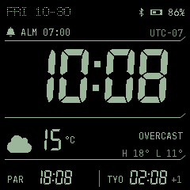
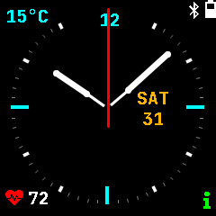
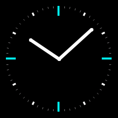
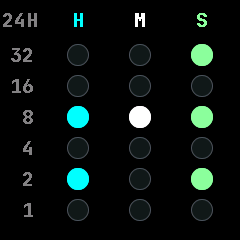
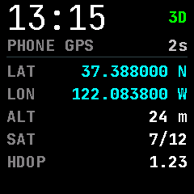
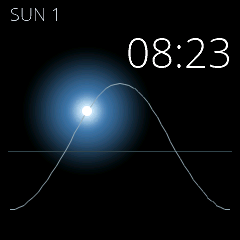
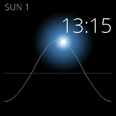

# PineTime firmware

Personal firmware for my PINE64 PineTime, developed for use with a Linux PinePhone. This project is a place for custom watch faces, simpler apps and experiments tailored to my own watch.

This is an **independently maintained derivative of [InfiniTime](https://github.com/InfiniTimeOrg/InfiniTime)**. The repository is standalone, and these changes are not intended for upstream integration. Future InfiniTime fixes may be incorporated selectively; updates are not imported automatically.

## Where the custom firmware lives

**The development firmware is on [`codex/wf4-draft`](https://github.com/Mathew-Hart/pinetime-firmware/tree/codex/wf4-draft).** This default `main` branch provides the project overview over a preserved upstream source snapshot. Build the draft branch to get the custom firmware.

The current draft is **1.16.1-wf4**, based on InfiniTime 1.16.1 at commit `e172b9b3c447e2b79c45510c751855a090a208b4`.

## Watch face screenshots

Native 240×240 software captures from the firmware’s LVGL rendering code, using synthetic sample readings. Solar is shown at two times of day. See [capture details and image provenance](codex/previews/watchfaces/README.md).

<table>
  <tr>
    <td align="center"><strong>Weather focus</strong><br></td>
    <td align="center"><strong>Analog with complications</strong><br></td>
  </tr>
  <tr>
    <td align="center"><strong>Elegant</strong><br></td>
    <td align="center"><strong>Binary</strong><br></td>
  </tr>
  <tr>
    <td align="center"><strong>Earth</strong><br></td>
    <td align="center"><strong>GPS</strong><br></td>
  </tr>
  <tr>
    <td align="center"><strong>Solar — morning</strong><br></td>
    <td align="center"><strong>Solar — afternoon</strong><br></td>
  </tr>
</table>

## What is different

- **Custom watch faces:** Weather focus with Paris and Tokyo clocks and an alarm indicator; Elegant with two hands and tick marks; Binary; Earth with day/night shading; Solar; and a phone GPS readout. Digital, Analog and Terminal are also included, for nine faces in total.
- **A selectable face cycle:** check the faces to include in Settings, then swipe right to left to cycle through them.
- **Analog complications:** weather temperature with a shortcut to Weather, plus heart rate sampled every ten minutes while the face is visible.
- **Clock Tools:** Alarm, Timer and Stopwatch combined in one app.
- **A simpler app profile:** games, Paint and Steps are removed. Motion-based wake controls and shake calibration are removed for the development watch, whose accelerometer is unavailable. An I²C diagnostic app helps investigate that sensor.
- **An optional Linux GPS companion:** forwards reports from an already-enabled phone GNSS source to the watch. PineTime has no GPS receiver of its own.

Weather, navigation and notification forwarding depend on separate phone integrations. This repository currently bundles only the optional GPS companion; cloning it does not install the rest of the PinePhone setup.

## Current status

**This is a development draft.** The latest GPS draft has been compiled and tested locally, but has not been installed on a watch. Its GPS companion has not been installed, and live phone-to-watch GPS remains unverified. Preview coordinates are synthetic test values.

Recorded checks passed: the ARM application build, 2,633 native assertions, 38 companion tests and six protocol interoperability cases. These checks do not establish live hardware behavior.

See the draft's [full documentation, previews, build instructions and test results](https://github.com/Mathew-Hart/pinetime-firmware/blob/codex/wf4-draft/README.md), [GPS companion guide](https://github.com/Mathew-Hart/pinetime-firmware/blob/codex/wf4-draft/codex/companion/README.md), and [recorded application-only DFU package](https://github.com/Mathew-Hart/pinetime-firmware/blob/codex/wf4-draft/codex/artifacts/pinetime-wf4-gps-draft-dfu.zip).

To work on the custom draft:

```sh
git clone --branch codex/wf4-draft --recurse-submodules https://github.com/Mathew-Hart/pinetime-firmware.git
cd pinetime-firmware
```

Follow the draft's build instructions after cloning. Nothing is installed on a phone or watch automatically.

## Origin and license

The firmware is derived from [InfiniTime](https://github.com/InfiniTimeOrg/InfiniTime), with its Git history and copyright notices retained. InfiniTime and these firmware modifications are distributed under [GPL-3.0-or-later](LICENSE). Dependencies, fonts and imagery retain their respective licenses and credits, documented in the [draft's attribution section](https://github.com/Mathew-Hart/pinetime-firmware/blob/codex/wf4-draft/README.md#license-and-attribution).
